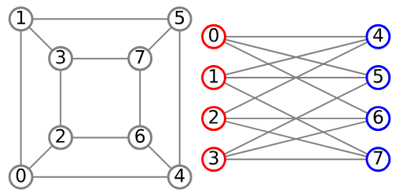

# Graph Isomorphism SAT

- používá [Glucose SAT solver](https://github.com/audemard/glucose)

## zadání

zadání: [sat projekt](https://ktiml.mff.cuni.cz/~svancara/files/sat-projekt.pdf)
problém: [graph isomorphism wikipedia](https://en.wikipedia.org/wiki/Graph_isomorphism_problem)

## použití:

`python3 graph_isomorphism.py -i input.in`

argumenty:

- `-i` / `--input` vstupní soubor

- `-o` / `--output` výstupní soubor cnf formule

- `-v` / `--verb` podrobnější výpis

- `-s` / `--solver` defaultně je glucose

předpřipravené vstupy:

- `sample_inputs/input0.in` 

- `sample_inputs/input1.in`

- `sample_inputs/input2.in`

- `sample_inputs/input3.in`

- `sample_inputs/not_isomorphism.in`

## zakodování:

### vstup

počet vrcholů a počet hran pak seznam hran mezi vrcholy, takhle pro oba grafy hned za sebou

#### obecně:

```
n_{0} m_{0}
u_{0} v_{0}
...
u_{m_{0}-1} v_{m_{0}-1}
n_{1} m_{1}
u_{0} v_{0}
...
u_{m_{1}-1} v_{m_{1}-1}
```

kde $G_0 = (V_{0}, E_{0})$ a $m_{0} = |E_{0}|$ a $n_{0} = |V_{0}|$ a k-tý řádek $u_{k} v_{k} \iff \{u_k, v_k\} \in E_{0}$ .Totožně pro $G_1$

#### příklad (z wikipedie):


[odkaz](https://en.wikipedia.org/wiki/File:Graph_isomorphisms.svg)

```
8 12
0 1
0 2
0 4
1 3
1 5
2 3
2 6
3 7
4 5
4 6
5 7
6 7
8 12
0 4
0 5
0 6
1 4
1 5
1 7
2 4
2 6
2 7
3 5
3 6
3 7
```

### výstup:

- jedno možné přejmenování

```
Izomorfní přejmenování vrcholů
0->3
1->5
2->7
3->1
4->6
5->0
6->2
7->4
```

### popis:

- potřeba najít takovou permutaci vrcholů z prvního grafu do druhého takovou, že se zachovají hrany mezi příslušnými vrcholy
- Definuji si grafy $G_{0} = (V_{0}, E_{0})$ a $G_{1} = (V_{1}, E_{1})$
- proměnná $p_{i,j}$
  - znamená, že vrchol $v_i \in V_0$ promítnu na $v_j \in V_1$

#### klauzule:

- alespon jedno promítnutí z vrcholu $v_i \in V_0$ na vrchol $v_j \in V_1$

  - $\bigwedge_{i=0}^{n-1} \bigvee_{j=0}^{n-1}p_{i,j}$

- nejvýše jedno promítnutí z vrcholu $v_i \in V_0$ na vrchol $v_j \in V_1$

  - $\bigwedge_{i=0}^{n-1} \bigwedge_{0 \leq j < k \leq n-1}( \lnot p_{i,j} \lor \lnot p_{i,k})$

- nejvýše jedno promítnutí vrcholu $v_j \in V_1$ z $v_i \in V_0$

  - $\bigwedge_{i=0}^{n-1} \bigwedge_{0 \leq j < k \leq n-1}( \lnot p_{j,i} \lor \lnot p_{k,i})$

- zakázat dvojice promítnutí, kdy bud v prvním nebo ve druhém grafu neexistuje mezi oběma vrcholy hrana

  - $(\lnot p_{a,b} \lor \lnot p_{c,d})$ pokud $(\{a,c\} \in E_0 \land \{b,d\} \notin E_1) \lor (\{a,c\} \notin E_0 \land \{b,d\} \in E_1)$
